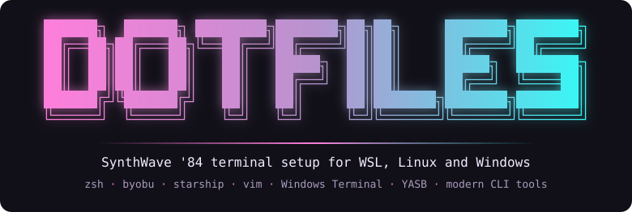

<p align="center">
  
</p>

```sh
gh repo clone spanthetree/dotfiles ~/dotfiles
~/dotfiles/install.cmd --packages     # Linux or WSL; on Windows: install.cmd
```

New machine, options, and how to uninstall: see [install](docs/install.md).

## Docs

| Doc | Covers |
|---|---|
| [Install](docs/install.md) | Linux/WSL and new-Windows-machine installs, options, uninstall, per-machine files, VS Code |
| [Hotkeys](docs/hotkeys.md) | keys this repo adds, then each app's defaults (byobu, zsh, fzf, vim, Windows Terminal, TUI tools, AI CLIs, Windows apps) |
| [Software](docs/software.md) | everything installed, with links |
| [Packages](docs/packages.md) | `packages.yaml`: adding, removing, updating, what's included |
| [Layout](docs/layout.md) | what each file in the repo is and where it is linked |
| [FAQ](docs/faq.md) | common questions: undo, native Linux, WSL vs Windows, keys, fonts |
| [Development](docs/development.md) | versioning and checks |
| [Changelog](CHANGELOG.md) | every release |

## Contributing

Pull requests are accepted only for verified bug fixes and interface improvements. For anything else (packages, themes, keys, tools), fork it and maintain your own copy however you like.

## License

[MIT](LICENSE)
